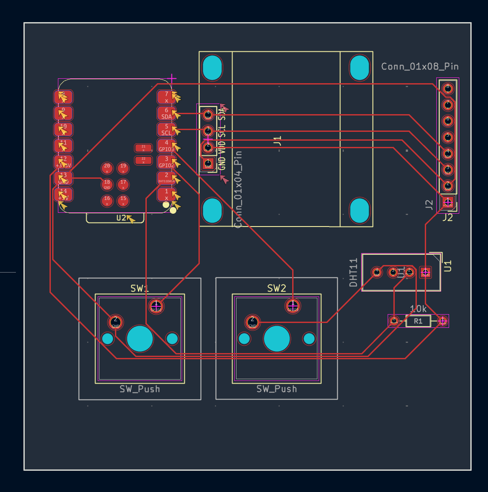
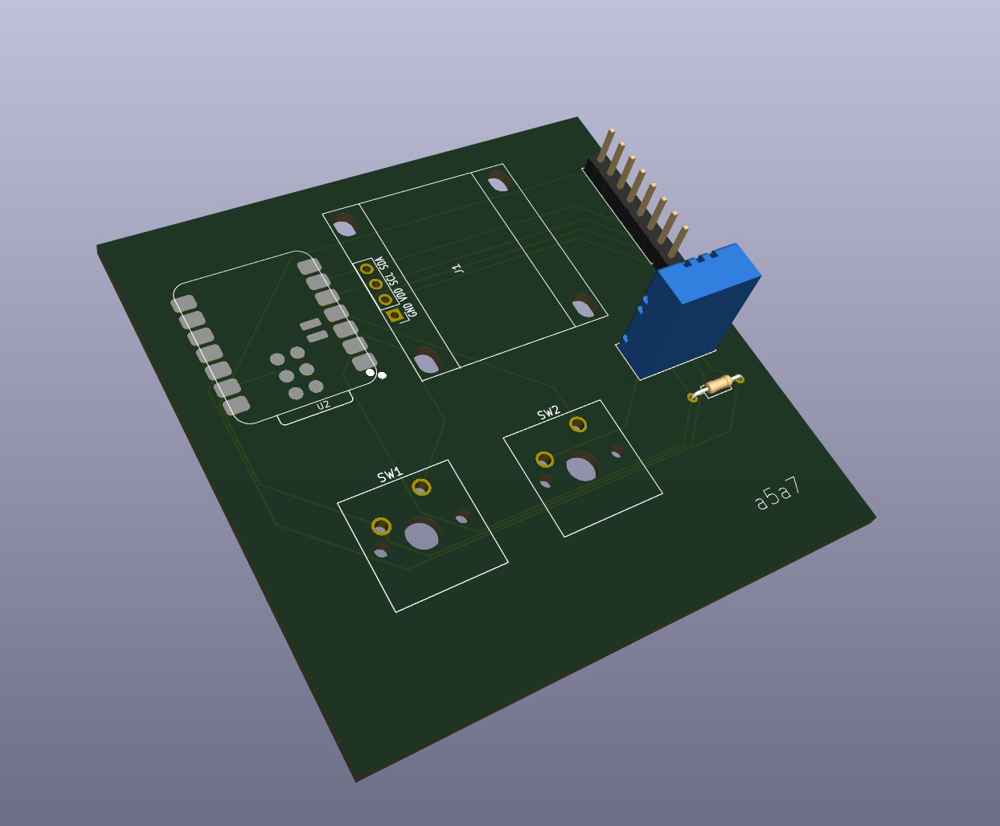

# Squarie

A tiny motion-controlled digital pet (think Tamagotchi) that lives on a 0.96" OLED.  Built for Halflife week 1, based on [Starbie](https://github.com/SharKingStudios/Starbie). It responds to a motion sensor, and buttons help it pick different actions.

## Why I made it

I wanted to learn how to design my own PCB. Starbie's pet is a star, but I went with a square. Why? Because it has a cleaner symmetry.

## How it works

| Input | What it does |
| --- | --- |
| Button 1 | Opens the radial menu, then confirms your choice |
| Tilt (in menu) | Moves the ball toward an action |
| Button 2 | Shows/hides stats (joy, energy, fullness, temperature, humidity) |
| Shake | Gives a small joy boost and wakes Squarie up |

Menu actions: **NAP** (sleeps with floating Zs), **PLAY** (runs laps across the screen), **FEED** (originally a jump, modified to additionally say "nom!"), **PET** (jumps with hearts).

### What changed from Starbie's firmware

- The sprite. More symbolic of squarie and it's corners.
  ```
  ......####################......
  .....######################.....
  .....##..................##.....
  .....##....##......##....##.....
  .....##....##......##....##.....
  .....##..................##.....
  .....##....#........#....##.....
  .....##.....########.....##.....
  .....##..................##.....
  .....######################.....
  ......####################......
  ........####........####........
  ```
- **New "nom!" reaction:** feeding Squarie now shows "nom!".

## The PCB



The board layout in KiCad. Top left is the XIAO ESP32-C3 (U2), the brain. Next to it, J1 is where the OLED plugs in and J2 (right edge) is the 8-pin header for the MPU6050 motion sensor. SW1 and SW2 at the bottom are the two buttons. The DHT11 temperature/humidity sensor (U1) and its 10k resistor (R1) sit on the right. The wiring took the longest time due to making sure they are non-interesecting. This is likely unoptimal wiring but hopefully it works.



A 3D render of the board with some parts placed: the MPU6050 header (back right), the DHT11 (blue), and the resistor.

Design files: [KiCad/](KiCad/) (schematic + PCB), [Gerber_Files.zip](Gerber_Files.zip) (to send to a PCB maker like JLCPCB), and [BOM.csv](BOM.csv) (parts list, about $23 total).

## Assembly

What I will hopefully do (will make adjustments as necessary):

1. Order the PCB using the Gerber files and get the parts from the BOM.
2. Solder the low, small parts first (the 10k resistor), then the XIAO, the buttons/switches, and the DHT11.
3. Solder on the pin headers and attach the OLED and the MPU6050 module.
4. Put keycaps on the switches.

## Flashing the firmware

I've already downloaded Arduino IDE and the libraries so I think it's just be this:

1. Open [firmware/squarie.ino](firmware/squarie.ino), plug the XIAO in over USB-C, and click Upload.

Might need to adjust the pins and the firmware accordingly if I see errors. 
